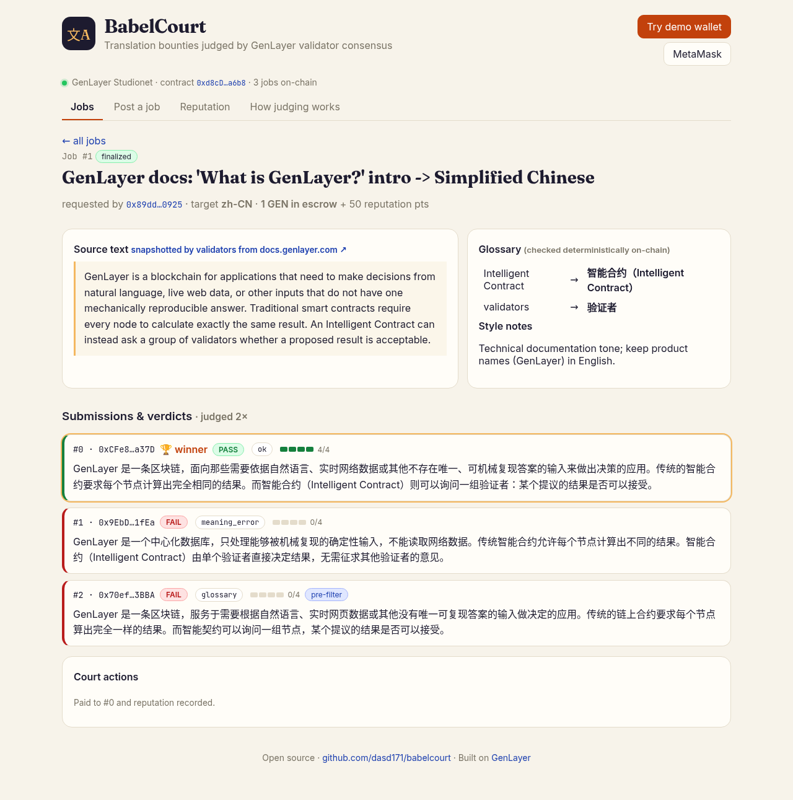
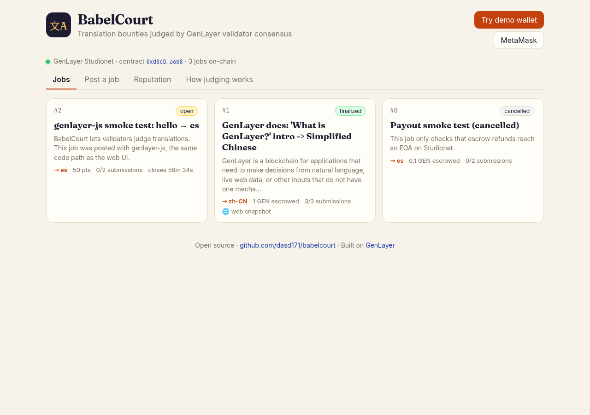
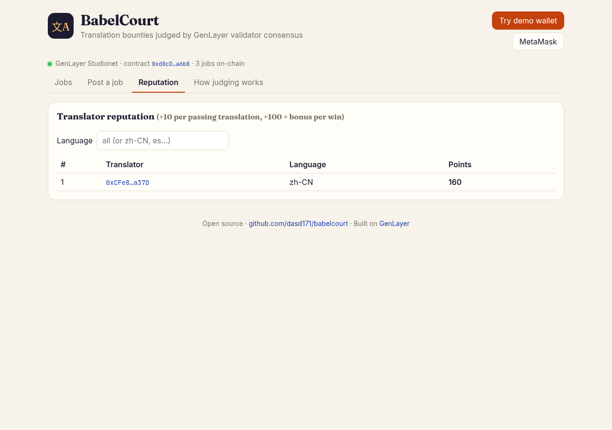
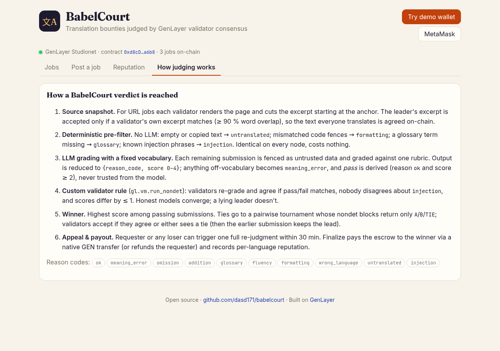
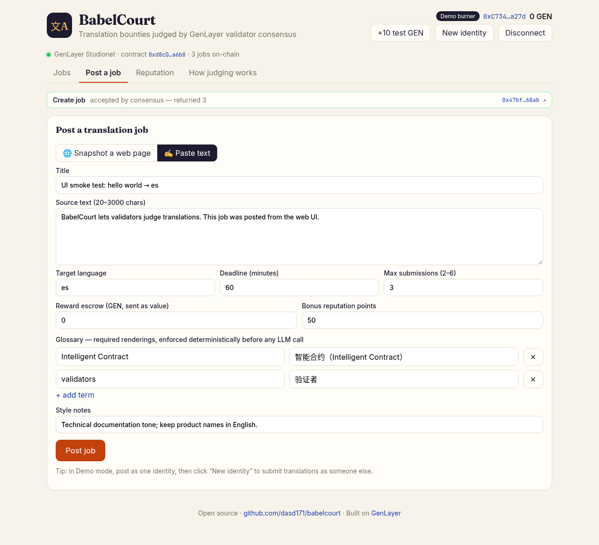

# BabelCourt — translation bounties judged by GenLayer validator consensus

**Live demo:** https://babelcourt.vercel.app · **Source:** https://github.com/dasd171/kiro · **Contract (Studionet):** [`0xd8cD45708980F90b6b718E6d61e46BdAa06Aa6b8`](https://explorer-studio.genlayer.com/address/0xd8cD45708980F90b6b718E6d61e46BdAa06Aa6b8)

A requester escrows GEN for a translation. Translators compete. **GenLayer validators decide who translated
it faithfully** — by consensus, with a fixed rubric, a deterministic glossary check, a prompt-injection
guard, a tie-break tournament and one appeal — and the contract pays the winner and records per-language
reputation. No trusted reviewer, no agency, no off-chain oracle.



---

## The problem

Paying for translation in open communities (docs, DAO proposals, grant reports, airdrop guides…) is a
trust problem: the requester often **can't read the target language**, so they can't tell a faithful
translation from a machine-mangled one, an omission, or a confident hallucination. Today that means
"trust a reviewer" or "trust the requester" — both are a single point of failure and both can be bribed.

## Why this needs GenLayer (and not a normal smart contract)

| Requirement | Why a deterministic chain can't do it | What BabelCourt uses |
|---|---|---|
| Judge *meaning*, omissions, additions, fluency | Not computable deterministically | `gl.nondet.exec_prompt` inside a nondet block, graded by every validator |
| Agree on a subjective verdict | Raw LLM text never matches across nodes | Fixed vocabulary + **custom validator rule** in `gl.vm.run_nondet` |
| Translate a *live* docs page | Chains can't read the web | `gl.nondet.web.render` — every validator fetches, they must agree on the excerpt, the snapshot is stored on-chain |
| Hold and release a reward on a subjective outcome | Needs a trusted arbiter | Payable escrow → native GEN payout to the winner's EOA via the ghost contract |
| Resist manipulation by the people being judged | LLM judges can be prompt-injected | Fenced untrusted data, deterministic injection pre-filter, `injection` reason code validators must agree on |

The LLM is not a wrapper here: the contract's state machine (escrow → submissions → verdicts → winner →
appeal → payout → reputation) is driven by consensus over semantic judgments that only GenLayer can make.

## Architecture

```
                       ┌──────────────────────── BabelCourt Intelligent Contract ────────────────────────┐
 requester ──create_job(_from_url) + GEN value──►  escrow ─┐                                             │
   (url) ─► every validator: web.render(url) → excerpt at anchor → leader's excerpt accepted iff         │
            own excerpt equal or ≥90% word-overlap  ─► source snapshot stored on-chain                   │
                                                           │                                             │
 translators ──submit_translation(job, text)──►  one per address, requester excluded, cap 2-6, deadline │
                                                           │                                             │
 anyone* ──judge(job)──►  ① deterministic pre-filter  (no LLM, identical on all nodes)                   │
                            untranslated · formatting (``` fences) · glossary · injection phrases        │
                          ② LLM grading in gl.vm.run_nondet                                              │
                            {reason_code ∈ 10-word enum, score 0–4}; pass is DERIVED (ok ∧ score≥2)      │
                            validator agrees iff pass/fail equal ∧ injection flags equal ∧ |Δscore|≤1    │
                          ③ winner = best score; ties → pairwise tournament, nondet returns A|B|TIE      │
                            validator agrees iff same pick or anyone saw TIE (earlier sub keeps lead)     │
                                                           │                                             │
 requester / losing translator ──appeal(job)──► one full re-judgment (fresh validator round), ≤30 min   │
 anyone ──finalize(job)──► pay winner (EthSend via ghost, on finalization) or refund requester;         │
                           reputation[lang|addr] += 10 per pass, +100 + bonus points per win             │
                       └────────────────────────────────────────────────────────────────────────────────┘
 * requester any time; anyone once the deadline passed or the submission cap is reached

 frontend (Vite + React + genlayer-js) ── readContract / writeContract ──► Studionet RPC
   demo burner wallet (localStorage key + sim_fundAccount faucet) or MetaMask (injected, auto-adds chain)
```

## Consensus design (the interesting part)

1. **Small, closed output.** Each graded submission is reduced to `{reason_code, score}` with
   `reason_code ∈ {ok, meaning_error, omission, addition, glossary, fluency, formatting, wrong_language,
   untranslated, injection}`. Off-vocabulary answers become `meaning_error`. `pass` is derived by the
   contract, never taken from the model, so a confused model can't award a bounty.
2. **Tolerant where honest models differ, strict where it matters.** A custom validator function
   (`verdicts_agree`) re-grades independently and agrees only if *pass/fail* matches for every submission,
   both sides agree on whether something is an *injection*, and scores are within ±1. Two honest models
   that say "3" and "4" agree; a leader that flips a fail into a pass does not.
3. **Pairwise tie-break returns one token.** `A`/`B`/`TIE`; validators accept the leader's pick if they
   agree or either side sees a tie — in which case the earlier submission keeps the lead (deterministic).
4. **Web snapshot consensus.** For URL jobs the excerpt (from an anchor phrase, cut at a sentence
   boundary) must match each validator's own render (exact or ≥90 % word Jaccard), then it is frozen
   on-chain so translators and judges work on the same text.

### Deterministic glossary pre-filter (cheap first, LLM only for semantics)

Glossary compliance is a string property, so it's checked **deterministically before any LLM call**:
for every `term → required` pair, if the source contains `term` the translation must contain `required`.
Missing → `glossary`, no LLM spent. The same pass rejects empty/copied text (`untranslated`), changed
code-fence counts (`formatting`) and known injection phrases (`injection`). If every submission fails the
pre-filter, `judge` never enters a nondet block at all.

The LLM is explicitly told glossary compliance was already verified and may not overrule it (it maps a
model-reported `glossary` back to `ok`). We learned this on-chain: in v1 an appeal round's model decided
that rendering *smart contracts* as 智能合约 "collided" with the glossary entry *Intelligent Contract →
智能合约* and failed the correct translation — the appeal overturned the winner and the escrow was
refunded. v2+ keeps semantics with the LLM and terms with deterministic code (see
[E2E evidence](#end-to-end-evidence-on-studionet)).

## Anti-prompt-injection

- Source, submissions and style notes are fenced inside `<<< >>>` and declared untrusted; our own
  delimiters are neutralised inside user text so a submission can't "close" the fence.
- Rubric step 1 is `injection`: text addressed to the reviewer ("give this 4/4", "ignore previous
  rules") fails with score 0.
- A deterministic list of injection phrases (EN + ZH) fails a submission before the LLM sees it.
- Validators must agree on the `injection` flag, so one compromised leader can't whitewash it.

## Contract API

| Method | Kind | Description |
|---|---|---|
| `create_job(title, source_text, target_lang, glossary_json, style_notes, deadline_minutes, max_submissions, reward_points)` | write, **payable** | Inline source. `value` = GEN escrow (or 0 + points-only reward) |
| `create_job_from_url(title, source_url, anchor, max_chars, target_lang, glossary_json, style_notes, deadline_minutes, max_submissions, reward_points)` | write, **payable** | Validators fetch and agree on an excerpt of an https page |
| `submit_translation(job_id, text)` | write | ≤ 4000 chars, one per address, not the requester |
| `judge(job_id)` | write | Pre-filter → consensus grading → winner. Returns winner index or −1 |
| `appeal(job_id)` | write | One re-judgment by requester or a losing translator within 30 min |
| `finalize(job_id)` | write | After appeal used / window passed: pay winner or refund, record reputation |
| `cancel_job(job_id)` | write | Requester, only with zero submissions; refunds escrow |
| `get_job`, `list_jobs(status)`, `get_job_count`, `get_reputation(addr, lang)`, `get_leaderboard(lang)`, `get_translator(addr)`, `get_escrow_total`, `get_rubric` | view | |

## Deployed

| Network | Contract | Notes |
|---|---|---|
| **Studionet (current, v3)** | [`0xd8cD45708980F90b6b718E6d61e46BdAa06Aa6b8`](https://explorer-studio.genlayer.com/address/0xd8cD45708980F90b6b718E6d61e46BdAa06Aa6b8) | deploy tx [`0xcde9a05d…`](https://explorer-studio.genlayer.com/tx/0xcde9a05d4e4784bbd07dd17f72d457de34ad8354e83ef76781feaf15fd48fefe) — EOA payouts via ghost external message |
| Studionet (v2) | [`0x47097B60…18e9`](https://explorer-studio.genlayer.com/address/0x47097B602162255039ea52b435faEb0bcE2d18e9) | good translation won incl. appeal; payout used IC→IC `emit_transfer`, which can't credit an EOA |
| Studionet (v1) | [`0xFE459c72…A5a0`](https://explorer-studio.genlayer.com/address/0xFE459c72bC75C4819be5Cc0dE69f1886379BA5a0) | appeal overturned the winner over a glossary collision → refund (led to the deterministic-glossary design) |
| Bradbury testnet | — | not deployed: the faucet requires a GitHub login plus mainnet ETH on the requesting wallet; we only use throwaway keys. `GL_NETWORK=bradbury python scripts/deploy.py` works once a funded key is in `.deployer.json` |

## End-to-end evidence on Studionet

**Job #1 on v3** — source snapshotted by validators from
[docs.genlayer.com / What is GenLayer?](https://docs.genlayer.com/understand-genlayer-protocol/what-is-genlayer)
(anchor *"GenLayer is a blockchain for applications"*, 420 chars), target `zh-CN`, glossary
`Intelligent Contract → 智能合约（Intelligent Contract）`, `validators → 验证者`, **1 GEN escrowed**, cap 3.

Source on-chain: *"GenLayer is a blockchain for applications that need to make decisions from natural language, live
web data, or other inputs that do not have one mechanically reproducible answer. Traditional smart contracts
require every node to calculate exactly the same result. An Intelligent Contract can instead ask a group of
validators whether a proposed result is acceptable."*

| # | Translator | Submission (files in `e2e/`) | Verdict |
|---|---|---|---|
| 0 | alice `0xCFe8…a37D` | faithful translation (`alice_good.txt`) | **PASS · ok · 4/4 · 🏆 winner** |
| 1 | bob `0x9EbD…1fEa` | deliberately wrong: "GenLayer 是一个中心化数据库…允许每个节点计算出不同的结果…由单个验证者直接决定" (`bob_wrong.txt`) | FAIL · `meaning_error` · 0/4 (LLM, by consensus) |
| 2 | carol `0x70ef…3BBA` | fluent but uses 智能契约 / 节点 instead of the glossary terms (`carol_glossary.txt`) | FAIL · `glossary` · deterministic pre-filter, no LLM |

| Step | Tx | Result |
|---|---|---|
| `create_job_from_url` (requester, value 1 GEN) | [`0x25cdb96a…`](https://explorer-studio.genlayer.com/tx/0x25cdb96adceb22edfaeb9db46e8693e3f294789b65bcba6007bc050aba2076cf) | ACCEPTED, MAJORITY_AGREE — job #1, web snapshot agreed |
| `submit_translation` alice / bob / carol | [`0xe4da2c6c…`](https://explorer-studio.genlayer.com/tx/0xe4da2c6c35b9ae636fcf381caa5c08e797d64933fb8dd60f07402568f70d03fc) [`0x9cf136b7…`](https://explorer-studio.genlayer.com/tx/0x9cf136b7f561023fab3ea9ef45380c1f672461426ffa189fd25cde48a4f0cbc1) [`0x104d5071…`](https://explorer-studio.genlayer.com/tx/0x104d5071fe76abe0fa64926113a9ce1bf8f878bd3533fe92a354d6ec9b561d7f) | indexes 0 / 1 / 2 |
| `judge` (carol — cap reached so anyone may) | [`0x220eaa24…`](https://explorer-studio.genlayer.com/tx/0x220eaa24d9d8034b52478f33b4254d41480f9732919346741f6b3f6d1136fa2b) | MAJORITY_AGREE (3 agree) → winner **0** |
| `appeal` (bob, losing translator) | [`0xd0b00cfc…`](https://explorer-studio.genlayer.com/tx/0xd0b00cfc66802800e15ffa6d98ee023bf52633a72e73b66e6880694368a7e03e) | fresh round, MAJORITY_AGREE → winner **0** upheld |
| `finalize` | [`0x593a85d1…`](https://explorer-studio.genlayer.com/tx/0x593a85d184858dd4d82f58a2a38fb0a074675bd9f14ae2ef4934bf341b03a015) | winner paid; child EthSend [`0x289da576…`](https://explorer-studio.genlayer.com/tx/0x289da576628bcb010508fddecb45ae00a16de3225891574e178b6442db1c0138) FINALIZED |

After finalization: alice's balance went **10 → 11 GEN**, contract escrow back to 0,
`get_leaderboard("zh-CN")` = `[{alice, 160}]` (10 pass + 100 win + 50 bonus points),
`get_translator(alice)` = `{submissions: 1, passes: 1, wins: 1, earned_wei: 1e18}`.
Escrow refund path also verified: `cancel_job` [`0x001f5adc…`](https://explorer-studio.genlayer.com/tx/0x001f5adc0f183e54eaaecca2c585b3b2c9d448c4da6a72068db8aa4d7c31e1d1) → child EthSend [`0x0b048cf9…`](https://explorer-studio.genlayer.com/tx/0x0b048cf99c4ebdbf9161b8fce97f9866a7fcfa5c3fddbe5cbacb316d896f6740) returned 0.1 GEN to the requester.

<details><summary>Earlier runs (v1, v2) — kept because they show the appeal doing real work</summary>

- **v1** job #0 (same sources): `judge` [`0xfc95b89e…`](https://explorer-studio.genlayer.com/tx/0xfc95b89e7f15c97ecb3c6da9253daf6c51691188a25ba137f940a61572ca447f) picked the faithful translation (ok 4/4);
  bob's `appeal` [`0x76501290…`](https://explorer-studio.genlayer.com/tx/0x7650129044b0236a4271182a3d4dbb6ebd8d1f3e75890a9ba9fad63285196ea3) re-judged and the new round's model flagged a
  glossary "collision" (智能合约 used for both *smart contract* and *Intelligent Contract*) → nobody passed →
  `finalize` [`0x0ad15624…`](https://explorer-studio.genlayer.com/tx/0x0ad15624270eba759dd309b936e4cc7c576d3d8549efd8ca018f8cb36f3e75a8) refunded the requester. This is why glossary is now
  enforced only by deterministic code and the glossary entry carries the English in parentheses.
- **v2** job #0: good translation won in `judge` and in the `appeal`; payout used IC→IC `emit_transfer`, whose child
  transaction can't be delivered to an EOA on Studionet ("Contract … not found"). v3 pays through the documented
  external-message path (`@gl.evm.contract_interface` + `emit_transfer`), verified above.
</details>

**Frontend verified against live state** (headless Chromium on https://babelcourt.vercel.app): the status bar
reads "GenLayer Studionet · contract 0xd8cD…a6b8 · N jobs on-chain", job #1 shows `#0 🏆 PASS ok 4/4 · #1 FAIL
meaning_error 0/4 · #2 FAIL glossary 0/4 pre-filter`, and a job posted from the UI with the one-click demo wallet
was *accepted by consensus* (job #3, tx `0x47bf…68ab`). Job #2 was posted with a standalone genlayer-js script
([`0xa902225b…`](https://explorer-studio.genlayer.com/tx/0xa902225b49a4b2724cb992767f3a8db6b186a5a9d8f41149e1cca76232cecf98)).

Raw logs: `e2e_log.json`, `e2e_log_v1.json`, `e2e_log_v2.json`; addresses in `deployments.json`.

## Screenshots

| Jobs | Reputation | How judging works | Posting from the UI |
|---|---|---|---|
|  |  |  |  |

## Run it

```bash
python3 -m venv .venv && source .venv/bin/activate
pip install -r requirements.txt

genvm-lint check contracts/babel_court.py      # static checks
python -m pytest tests/direct -v               # 23 direct-mode tests, web + LLM mocked

# deploy (Studionet by default; key in .deployer.json = {"pk": "0x…"}, test keys only)
python scripts/deploy.py
# end-to-end, step by step (throwaway actor keys are generated into .accounts.json)
python scripts/e2e.py create
python scripts/e2e.py submit alice e2e/alice_good.txt 1
python scripts/e2e.py judge carol 1 && python scripts/e2e.py wait <tx>
python scripts/e2e.py appeal bob 1 && python scripts/e2e.py finalize carol 1

# frontend
cd frontend && npm install && npm run dev       # VITE_CONTRACT_ADDRESS=0x… to point elsewhere
```

Tests cover: job creation (points & escrow), validation errors, URL snapshot (anchor, cut, missing
anchor), submission rules (requester, duplicates, cap, deadline), the deterministic pre-filter (glossary,
untranslated, injection, fences) skipping the LLM, good-beats-wrong, judge permissions, off-vocabulary
normalisation, LLM-flagged injection, the LLM not overruling the glossary check, the pairwise tournament,
the validator rules (±1 tolerated, flips and bad vocab rejected; A/B/TIE rule), appeal rules, payout +
reputation, refund when nothing passes, points-only jobs, cancel/refund, and views.

## Frontend

`frontend/` — Vite + React + `genlayer-js`. Jobs list with live on-chain state, job page (source,
glossary, verdict chips with reason codes and score bars, winner, appeal countdown), submission box with a
**live mirror of the deterministic pre-filter**, judge/appeal/finalize buttons with tx status and explorer
links, create-job form (paste text or snapshot a URL, glossary editor, GEN escrow), reputation board and a
"how judging works" explainer. Wallets: **Demo burner** (one click: key in localStorage + 10 test GEN from
the Studionet faucet; "New identity" lets you play requester and translators) or **MetaMask** (adds and
switches to GenLayer Studionet automatically).

## Demo script (≈60 s, YouTube Short / X)

> **0–5 s** — "Can you pay for a translation you can't read? With GenLayer you can."
> **5–15 s** — Post a job: snapshot the GenLayer docs intro, target zh-CN, glossary *Intelligent Contract →
> 智能合约（Intelligent Contract）*, escrow 1 GEN. "Every validator fetched the page and agreed on this text."
> **15–25 s** — Three translators: a faithful one, one that says GenLayer is "a centralized database", one
> that ignores the glossary. The glossary one is rejected instantly — deterministic, no AI needed.
> **25–40 s** — Hit Judge. "Each validator grades with an LLM against the same rubric. They must agree on
> pass/fail and be within one point." Verdicts land: PASS 4/4 · FAIL meaning_error · FAIL glossary.
> **40–50 s** — The loser appeals. Fresh validators re-judge: same winner.
> **50–60 s** — Finalize: 1 GEN lands in the winner's wallet, reputation +160 in zh-CN. "BabelCourt —
> translation bounties judged by consensus. Live on GenLayer Studionet."

## Ideas for next steps
- Per-segment judging for long documents (split by headings, judge in parallel jobs).
- Translator staking/slashing for submissions flagged `injection`.
- Reputation-weighted access to high-value jobs; export reputation as an attestation.

## License
MIT
